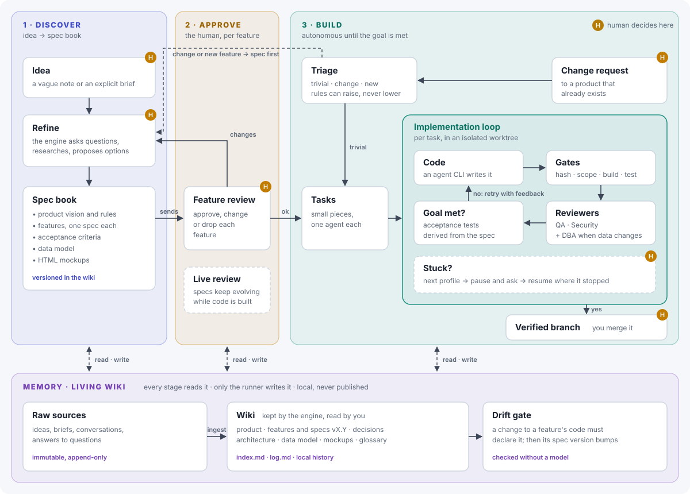

# AEH — Autonomous Engineering Harness

AEH is a product-cycle engine: it takes a product from a first idea to verified, documented code, and keeps a private memory of everything it learned along the way. See the [vision](docs/vision.md) for the full cycle: discover, approve, build, remember.



The runner decides; models only propose.

## What works today

The build stage. AEH turns an approved outcome into verified code on its own branch. You decide what to build and approve the acceptance tests; AEH runs agent CLIs (Codex, Claude Code, a local model) in isolated git worktrees and accepts a change only when deterministic gates pass. The rest of this README describes that engine.

> **Status: MVP-1.** Worktrees separate Git changes. Agent CLIs and build/test commands run with your user's permissions, subject to any sandbox configured on the CLI itself. Use trusted repositories, profiles, and commands until AEH has a process sandbox.

## Install

```sh
go install github.com/robbitoe/aeh/cmd/aeh@latest
```

Requires Go 1.24+, git, and the agent CLIs your profiles use.

### Agent profiles

The `aeh init` template was checked against Codex CLI 0.167.2 and Claude Code 2.1.322 on Windows:

- Every profile reads the prompt from stdin (`stdin: true`). On Windows the CLIs are `.cmd` shims, and `cmd.exe` cuts a multi-line argument at the first newline.
- Claude Code runs with `--safe-mode`, so your personal `CLAUDE.md`, plugins, hooks and MCP servers do not change the run (this also turns off any personal hooks you use as safety checks; managed policies still apply), and with `--permission-prompts none`, so anything that would ask for permission is denied instead of waiting. `acceptEdits` lets it edit files; add `--allowedTools` entries if it should run your build or tests.
- `claude-review` is a read-only reviewer (`--tools Read,Grep,Glob`) for when Codex implements; `codex-review` is the reverse.
- `local` points Claude Code at LM Studio's Anthropic-compatible endpoint. Set the port your server uses and a model it has loaded.
- Unattended runs need sign-ins that last. Codex keeps the one from `codex login`. For Claude Code, `claude setup-token` prints a long-lived token without saving it: put it in the `CLAUDE_CODE_OAUTH_TOKEN` environment variable and list `CLAUDE_CODE_OAUTH_TOKEN` in `pass_env`, since agents receive only OS and tool-discovery variables plus `pass_env`.

## Quick start

```sh
cd your-project
aeh init                               # creates aeh/config.yaml and an example outcome
# 1. edit aeh/config.yaml: build and test commands, agent profiles
# 2. write aeh/outcomes/OUT-001.yaml and its acceptance tests
aeh tests approve OUT-001              # seal the tests you approved
git add -A && git commit -m "OUT-001 contract and acceptance tests"
aeh run OUT-001                        # runs until accepted or blocked
aeh status
```

When an outcome is accepted, the work is on branch `aeh/OUT-001`. Review it and merge it yourself. AEH never touches your other branches.

For small changes that don't need sealed tests:

```sh
aeh do "fix the null check in FeeService.Calculate" --paths src/Fees/
```

## How a task runs

1. A fresh worktree is created from `aeh/<ID>`.
2. The profile's CLI receives the prompt: outcome, criteria, task, rules, and the previous failure if there was one.
3. AEH creates a candidate commit on the pinned base and checks it out in a clean verification worktree. Gates run in order and stop at the first failure. None of them calls a model:
   - **hash**: the sealed acceptance tests are unchanged;
   - **scope**: compare the candidate with its pinned base and enforce protected paths, task paths and the diff limit. Agent instruction files (`AGENTS.md`, `CLAUDE.md`, `.claude/`, `.codex/`) and Git control files (`.gitattributes`, `.gitmodules`, `.lfsconfig`) and submodule pointers may not change in any directory. Binary changes fail when Git cannot count their lines;
   - **build**: your build command (put lint here);
   - **test**: your test command.
4. Level-2 outcomes require a separate `reviewer` profile that exits successfully and writes one verdict on the final nonempty line of plain stdout. Use `VERDICT: APPROVE` or `VERDICT: REJECT`. Configure a plain-text reviewer rather than a JSON/JSONL stream.
5. If everything passes and the verification checkout remains clean, `aeh/<ID>` advances to the candidate commit. The runner checks that the branch still points to the expected base before advancing.

On failure the attempt is discarded. The ladder is: retry with the same profile and the failure as feedback, then try the next profile, then block with a question. Answer it with `aeh answer <ID> "..."` and run again.

Only timeouts and cancellations kill the agent, reviewer or gate command's process tree on Windows (a Job Object) and Unix (a dedicated process group), block immediately and retain the affected worktree. Background processes left by a command that exits normally keep running. Windows cancellation waits for member process objects to become signaled, within a two-second cleanup deadline; a failed wait returns a cleanup error. External services such as file scanners can still briefly hold log files after those processes exit. This is cleanup, not a process sandbox: Unix descendants that leave the process group can escape it. Windows processes started on the agent's behalf by another service can also escape the job, for example through WMI `Win32_Process.Create`, `schtasks`, out-of-process COM or `ShellExecute` via Explorer. Confirm the processes have stopped and inspect possible effects before answering. When you have finished inspecting the retained worktree, remove it with Git. Resume requires the same contract and recorded branch head. The contract covers the outcome, sealed tests, prompts, build and test commands, `pass_env`, protected paths and limits; profiles, task start profiles, ladder, reviewer, notify and timeouts may change between runs. Use a new outcome ID when intentionally changing the contract or when old state lacks those records.

After the last task, build and tests run once more on the integrated branch. Accepted means proven there.

## Levels

| Level | Use for | What runs |
| --- | --- | --- |
| 0 | Typos, obvious fixes | Nothing: use your agent CLI directly |
| 1 | Small change with a clear criterion | `aeh do`, or an outcome with `level: 1`: gates only |
| 2 | Business rules, data, money, concurrency | Sealed acceptance tests, gates and cross review |

Start at the lowest level that fits.

## Files

```
aeh/                      committed
  config.yaml             commands, limits, ladder, profiles, webhook
  outcomes/OUT-001.yaml   the contract
  seals/OUT-001.json      the acceptance tests you approved, by hash
  prompts/*.md            optional overrides of the built-in prompts
.aeh/                     local, git-ignored
  state/                  progress per outcome
  runs/<ID>/<task>-a<n>/  prompt, agent output, candidate SHA, diff, gate results
  reports/<ID>.md         evidence report
  pending/<ID>.json       accepted changes still to be written to memory
  memory/                 product memory: its own local Git repository, no remote
```

Attempt and verification worktrees are created in your user cache directory. Ordinary completed attempts are removed. Keeping them outside the repository avoids inheriting instructions from the parent project and prevents build tools from globbing the temporary worktrees.

Agent and gate processes inherit a limited set of OS and tool-discovery variables. List any other variable names they need (for example `JAVA_HOME` or a proxy) in `pass_env`. Use the profile's `env` mapping for explicit agent variables, with references to existing environment variables for credentials. Keep values out of tracked config. Home directories remain accessible with the user's permissions. Git variables such as `GIT_CONFIG_GLOBAL` are not inherited either; set `safe.directory` and similar options in your global or system Git config. Provider quota stays unknown unless a profile supplies a distinct, documented `quota_exit_codes` signal. That signal is recorded as an agent failure and follows the configured ladder.

Make sure your project's `.gitignore` covers build output (`bin/`, `obj/`, `node_modules/`). Otherwise the scope gate sees it as part of the change.

## Commands

| Command | What it does |
| --- | --- |
| `aeh init` | Creates `aeh/config.yaml`, an example outcome, and ignores `.aeh/`. |
| `aeh tests approve <ID>` | Seals the outcome's acceptance tests. |
| `aeh run <ID>` | Runs the outcome. Exit code 0 accepted, 3 blocked, 1 error. |
| `aeh do "<change>" [--paths a/,b/] [--profile name]` | Level-1 change with one task. |
| `aeh answer <ID> "<text>"` | Answers a blocked outcome; the answer goes into the next prompt. |
| `aeh status` | Status, tasks and attempts of every outcome. |
| `aeh notify test` | Sends a test event to the webhook. |
| `aeh memory init` | Creates the product memory in `.aeh/memory/` of the main checkout. |
| `aeh memory new <feature> --title "..." --paths a/**` | Adds a feature spec at version 0.1.0. |
| `aeh memory status` | Features, versions, last accepted change and pending records. |
| `aeh memory lint` | Checks the memory and its privacy settings. |
| `aeh memory record <ID>` | Retries a memory record that failed after an outcome was accepted. |

### Product memory (in progress)

The memory is a local wiki in `.aeh/memory/` of the project's main checkout, also when you run from a linked worktree. It is its own Git repository with no remote, and the project ignores `.aeh/`, so aeh does not publish it. Each feature has a spec with a version and the paths it owns; `index.md` and `log.md` are maintained by aeh. Only aeh commands write it, one at a time per project. You can edit spec text by hand and commit it inside the memory repository; aeh refuses to record on top of uncommitted changes. Linking an outcome to a feature (`--feature`) and the drift gate arrive in the next step of stage 1.

## Roadmap

The engine above is the build stage of the [vision](docs/vision.md). Next, in order:

1. **Memory.** A private wiki in `.aeh/memory/` with versioned specs, kept in sync with the code by a deterministic drift gate.
2. **Triage and reviewers.** Trivial, change and new routes, with QA, Security and DBA reviewers chosen by route.
3. **Specs to code.** An approved feature produces its tasks and acceptance tests.
4. **Discovery.** From a vague idea to a spec book with HTML mockups.
5. **Live review.** Specs keep evolving while approved features are built.
6. **Sandbox.** Agents in a container with no network by default.

Until then, outcomes, tasks and acceptance tests are written by hand or with your agent CLI.

## Development

Go standard library only, plus `gopkg.in/yaml.v3`. One file per responsibility in `internal/aeh`. Before any change:

```sh
go vet ./...
go test ./...
```

Agent instruction files (`AGENTS.md`, `CLAUDE.md`, `.claude/`, `.codex/`), agent coordination notes (`.agents/`) and local state (`.aeh/`) are git-ignored: they stay on your machine. Design decisions are recorded in [docs/adr](docs/adr).

## License

[MIT](LICENSE).
