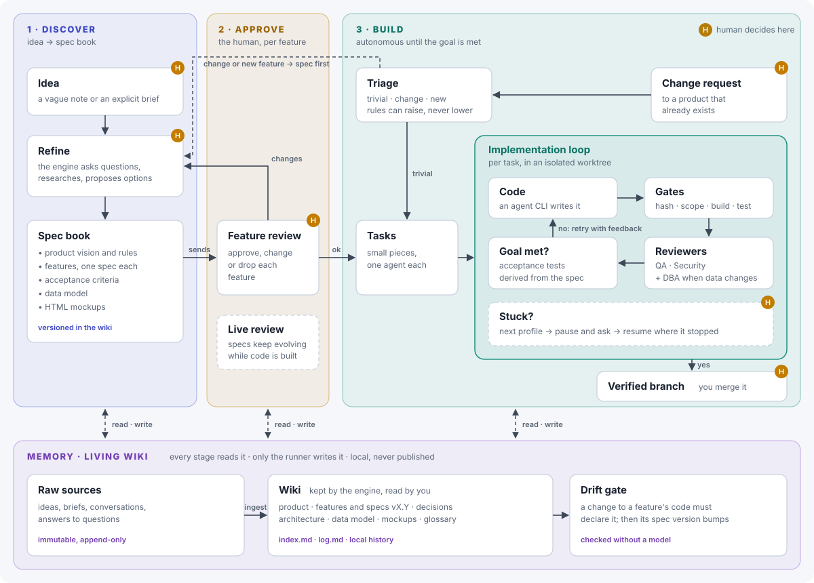

# AEH — Autonomous Engineering Harness

AEH is a product-cycle engine: it takes a product from a first idea to verified, documented code, and keeps a private memory of everything it learned along the way. See the [vision](docs/vision.md) for the full cycle: discover, approve, build, remember.



The runner decides; models only propose.

## What works today

The whole cycle: discovery from an idea (or adoption of an existing system), owner approval of versioned specs, and the build stage. AEH turns an approved feature spec into a plan, sealed acceptance tests and verified code on its own branch. You approve the spec; AEH generates, checks, independently reviews and seals the tests. Manual outcomes remain supported with owner-approved tests. AEH runs agent CLIs (Codex, Claude Code, a local model) in separate git worktrees and accepts a change only when deterministic gates and independent reviews pass.

> Worktrees separate Git changes. Build, test and acceptance commands, which run code an agent just wrote, can run in a local Docker container with no network, no forwarded host credentials and no Git metadata: see [Sandbox](docs/sandbox.md). Secrets committed to the repository or built into the image are not removed. Agent CLIs still run with your user's permissions, subject to any sandbox configured on the CLI itself, so use trusted repositories and profiles.

## Install

Download the archive for your system from the [releases page](https://github.com/robbitoe/aeh/releases) and put `aeh` on your `PATH`, or build it with Go 1.24+:

```sh
go install github.com/robbitoe/aeh/cmd/aeh@latest
```

AEH also needs git and the agent CLIs your profiles use. New to AEH? Start with the [getting started guide](docs/getting-started.md).

### Agent profiles

The `aeh init` template was checked against Codex CLI 0.167.2 and Claude Code 2.1.322 on Windows:

- Every profile reads the prompt from stdin (`stdin: true`). On Windows the CLIs are `.cmd` shims, and `cmd.exe` cuts a multi-line argument at the first newline.
- Claude Code runs with `--safe-mode`, so your personal `CLAUDE.md`, plugins, hooks and MCP servers do not change the run (this also turns off any personal hooks you use as safety checks; managed policies still apply), and with `--permission-prompts none`, so anything that would ask for permission is denied instead of waiting. `acceptEdits` lets it edit files; add `--allowedTools` entries if it should run your build or tests.
- `claude-review` is a read-only reviewer (`--tools Read,Grep,Glob`) for when Codex implements; `codex-review` is the reverse.
- Every step whose result aeh reads from the agent's last line needs plain text output: discovery, adoption, the plan author, every reviewer and, since implementers may end with `SPEC-QUESTION:`, the implementers too. Use `--output-format text` for Claude Code. A profile with `--output-format json` wraps that line inside a JSON object: a verdict is lost and the step fails, and an implementer's question is lost, so the attempt counts as a normal failure instead of pausing.
- Discovery and its book review run in a fresh output directory that is not a Git repository, and Codex refuses such a directory ("Not inside a trusted directory") unless it gets `--skip-git-repo-check`. The template's Codex profiles carry the flag; add it to Codex profiles in an existing `aeh/config.yaml`. The flag only turns off that directory check: aeh always chooses the directory, and the `--sandbox` mode still applies.
- `local` points Claude Code at LM Studio's Anthropic-compatible endpoint. Set the port your server uses and a model it has loaded.
- Unattended runs need sign-ins that last. Codex keeps the one from `codex login`. For Claude Code, `claude setup-token` prints a long-lived token without saving it: put it in the `CLAUDE_CODE_OAUTH_TOKEN` environment variable and list `CLAUDE_CODE_OAUTH_TOKEN` in `pass_env`, since agents receive only OS and tool-discovery variables plus `pass_env`.

## Quick start

```sh
cd your-project
aeh init                               # creates aeh/config.yaml and an example outcome
# 1. edit aeh/config.yaml: build and test commands, agent profiles
# 2. write aeh/outcomes/OUT-001.yaml and its acceptance tests
aeh tests approve OUT-001              # seal the tests you approved
git add -A && git commit -m "OUT-001 contract and acceptance tests"
aeh run OUT-001                        # runs until accepted or blocked
aeh status
```

When an outcome is accepted, the work is on branch `aeh/OUT-001`. Review it and merge it yourself. AEH never touches your other branches.

For small changes that don't need sealed tests:

```sh
aeh do "fix the null check in FeeService.Calculate" --paths src/Fees/
```

## From an idea to a draft book

Discovery turns an idea into a draft book of specs in memory, through rounds of an agent's questions and your answers. It needs initialized memory and a configured ladder.

```sh
aeh discover new shop "A small online shop for handmade goods"
aeh discover run shop                 # round 1: the agent asks, or writes the book
aeh discover show shop                # questions R1-Q1, R1-Q2, ... with why and options
aeh discover answer shop R1-Q1 "Consumers only"
aeh discover skip shop R1-Q2          # optional questions only
aeh discover run shop                 # next round, with the latest answer to each question
```

A round ends with questions or with the draft book. Blocking questions must be answered before the next round.

You choose the technology stack. In a project that starts from scratch (no committed file besides `aeh/` and housekeeping such as `.gitignore`, README and LICENSE), the agent must first ask a blocking question with `topic: stack`; aeh refuses a book until you answered it. In an existing project the agent receives the stack its committed files show (manifests, file types, configured commands) and keeps it, unless the idea or your answers ask for another; then it confirms the change with a stack question first.

If the advisory review of the book has no verdict (for example the reviewer's profile was misconfigured), fix the cause and run `aeh discover review <slug>`. A review with a verdict is never replaced. Answering again records a revision, and the next round receives only the latest one. The book has `vision.md`, `data.md`, one `features/<feature>.md` per feature with acceptance criteria, and optional HTML mockups. It is stored under `wiki/discovery/<slug>/drafts/` in memory. Drafts are not features: they claim no paths, and no run sees them.

Each feature draft starts with strict YAML front matter containing exactly `title` (one display line, at most 200 bytes) and `paths` (1-20 repository-relative paths). Unknown fields, YAML anchors and explicit tags are rejected. Draft slugs must be new, and paths of different drafts must not overlap. Criteria must be present, non-empty, numbered from 1 without gaps, and must not use `observed`:

```markdown
---
title: Cart
paths: [src/cart/**, web/cart/**]
---
# Cart
The cart holds items.

## Acceptance criteria
- AC-1: Given an empty cart, when the user adds an item, then the cart has one item.
```

Before import, the first independent QA profile reviews the frozen book using `review-book.md` (the legacy `reviewer` setting remains supported). The review is advisory: `approve`, `reject`, `invalid`, `unavailable`, `interrupted` and `not_run` are explicit evidence states, and none prevents import. Findings become optional questions attributed to the reviewer. `show` and `.aeh/reports/discover-<slug>.md` show the reviewer, provider, book digest and whether the review is stale after committed draft edits. A stopped review resumes on the saved snapshot without running the author again.

Promote and accept are explicit owner actions:

```sh
aeh discover promote shop cart       # creates wiki/features/cart/spec.md at 0.1.0
aeh memory approve cart              # separate approval of the spec
aeh plan cart
aeh discover accept shop vision      # wiki/vision.md, or wiki/vision.next.md if it exists
aeh discover accept shop data        # wiki/data.md, or wiki/data.next.md if it exists
```

A draft named after an existing feature is a revision of it. When the book is imported, AEH validates it against the feature's history and the product (kept criteria keep their numbers, removed numbers stay retired, new criteria go above the highest number ever used; new paths must not belong to another feature or adopted area, and an adopted feature keeps its paths) and writes it to `wiki/features/<feature>/spec.next.md` with its session, draft digest, base commit and criteria diff. That file is then the revision's only source: edit and commit it there. Each feature has at most one pending revision; another session's revision of it is refused. `aeh discover promote <slug> <feature>` writes it as the next, unapproved version of `spec.md` (a minor version above every version the spec had or the owner approved), keeps the changelog, history and implementations, and removes `spec.next.md` in the same memory commit; a revision whose spec changed after the import is stale and is refused. `aeh discover discard <slug> <feature>` removes a pending revision. `aeh memory status` lists pending revisions.

When a version changes a feature's paths, the feature owns the union of its old and new paths until that version is implemented: its plan may move or retire the old code, the drift gate counts both, and no other feature may claim the old paths. Moving code requires new or changed criteria; a version that only changes paths is planned as a plan without implementation whose record reassigns ownership and releases the old paths. For implementations recorded before paths were stored, AEH recovers their paths from the matching approved spec in memory history (`legacyImplementationPaths`) and includes them in the union. Features adopted from existing code keep their paths for now; after their characterization is accepted, changed or removed criteria retire their sealed characterization tests like any other, and `observed_base_sha`, the owner's decisions and the historical numbers are kept.

Promotion reads the committed draft from memory HEAD and revalidates it against existing features and their paths. Resolve conflicts by editing and committing the draft in the memory repository; no agent reruns. The promoted spec must also meet the existing spec format, including its 120-byte title limit. Repeating promotion or acceptance of unchanged draft content succeeds without another memory commit. Vision and data are advisory: neither enters feature approval digests nor run contracts. Each command refreshes the discovery report, which includes rounds, attempts, redacted feedback, answers and owner actions.

The agent writes only into an output directory that aeh opened before the agent ran. aeh freezes that output against an exact list of allowed files and limits. Then it checks the output:

- Text: restricted Markdown, with no HTML, no character references and no external images.
- Secrets: known secret formats are rejected. A diagnostic gives the line and kind, never the value.
- Mockups: each mockup is rebuilt from an allowlisted HTML fragment inside a page with a restrictive Content Security Policy.

A rejected attempt goes back to the agent as feedback, and the discovery ladder works like the build ladder. Each step is one marked memory commit. A step interrupted after aeh saved it finishes on the next discovery command.

The idea and your answers go to the configured agent provider inside the prompt. Web research is off by default (`discovery.research`). aeh cannot stop a CLI from using the web if its profile allows it, so choose discovery profiles without web tools.

```yaml
discovery:
  ladder: [strong]           # defaults to the build ladder
  max_questions: 7
  max_features: 12
  max_mockup_bytes: 204800
  research: false
```

## Adopting an existing system

Initialize local memory with `aeh memory init`, then run `aeh adopt inventory` to inspect
the main checkout's HEAD in a disposable detached worktree. Use `--base <rev>` to inspect
another commit. The runner pins its full SHA, removes possible secret files before the
agent runs, and checks that the agent changed no checkout files, including ignored files.
These checks detect changes; agent profiles remain cooperative until sandboxing is added.
Secret filtering is best effort. Configure read-only agent profiles for adoption.

```yaml
adopt:
  ladder: [codex-inspect] # defaults to the build ladder; profiles must exist
  exclude: [private/**] # additional repository-relative secret file patterns

profiles:
  codex-inspect:
    provider: openai
    command: ["codex", "exec", "--sandbox", "workspace-write", "--add-dir", "{{output_dir}}", "-"]
    stdin: true
```

An adoption agent works in the inspection checkout and writes its output to a directory aeh
opens outside it. `{{output_dir}}` in a profile's command is replaced with that directory, so
a CLI with a sandbox can be allowed to write there (`--add-dir` in Codex and Claude Code). Only
profiles in `adopt.ladder` may use it; the configuration refuses it anywhere else.

Basenames `.env*`, `*.pem`, `*.key`, `id_*`, `*.pfx`, `credentials*`, and `secrets*` are
excluded case-insensitively. Tracked symbolic links and reparse points are also removed
before inspection. Agents receive only excluded paths, never link targets. Each profile gets two
tries; an exhausted ladder blocks, and running the command again retries it.

The inventory becomes `wiki/system.md` in private memory, with base SHA, date and profile.
Later inventories become `wiki/system.next.md`; `aeh adopt accept system` replaces current
with next in one memory commit. Repeating acceptance is a no-op. The retained next file is
an audit copy after acceptance; local state marks whether it is pending.
Suggested configuration stays in `.aeh/adopt/config.suggested.yaml`. AEH never executes it.
The owner copies accepted settings into `aeh/config.yaml`, then runs `aeh adopt verify`.
Verification runs only configured build and test commands, through the gate shell runner
with its timeout and process-tree cleanup, at the pinned base. It rejects tracked changes
and new files unless project `.gitignore` files ignore them. Links are recorded by target
without following them; new ignored links are allowed, while changed or removed existing
links and links replacing tracked files or directories fail verification. Evidence, including command
exit codes, duration and the configuration digest, is saved in `.aeh/adopt/verify.json`.

```sh
aeh adopt area billing --paths src/billing/ --title "Billing"
aeh adopt show billing
aeh adopt confirm billing AC-1 keep --seen <token-from-show>
aeh adopt promote billing
aeh memory approve billing
aeh adopt seal billing
git merge aeh/billing-v0_1_0     # you merge the characterization tests
aeh adopt status
```

Area observations cite regular files inside the supplied paths at the pinned base, with
start and end lines within the file's line count. Refreshing an area can re-observe active
IDs; paths stay fixed. `--title` is only for a new area; edit `area.md` to change an existing
title. Confirm every observation
as `keep`, `bug` or `drop` before promoting. Promotion requires at least one keep, preserves
its original AC numbers (gaps included), and permanently reserves retired observation IDs.
It creates an unapproved 0.1.0 spec; it does not claim implementation or characterization.
Repeating promotion is a no-op only while the promoted spec's exact bytes remain at memory HEAD.
`aeh adopt seal <feature>` characterizes an approved adopted feature: it runs `aeh plan` in an
explicit characterize mode. The test author writes tests and a `plan.yaml` with
`kind: characterize` and no task. Every check of a plan applies, with red turned to green:
each new test file must pass on the existing code on its own, all of them together, and the
previous acceptance suite with them added. QA reviews with a characterization prompt;
the route and reviewers come from the rules that overlap the area's paths and the files the
tests change, and only go up. The verified commit is published on `aeh/<ID>` and recorded in
memory as the feature's first implementation: `code_sha` is that published commit and
`observed_base_sha` the commit the area agent inspected. `aeh run` refuses a
characterization: there is nothing to implement; merge the branch. `aeh plan` refuses an
adopted feature until it is characterized, and plans its next version (for example a fix
for a `bug` observation, as a new criterion) only after you merged the characterization.

`aeh adopt status` lists each area as observed, confirmed, promoted, characterizing,
characterized (verified, being published), published or merged, and uncovered groups of
tracked files at the accepted inventory's base and date. Files not matched by any feature
or area path are grouped by their first two path segments; partially covered groups remain visible.
Every adoption command regenerates `.aeh/reports/adopt.md` with inventory, inspection,
verification and promotion evidence. All memory changes use recoverable pending imports.

An existing system without documentation is adopted area by area. An agent reads an area of the code at a pinned commit and reports observations: behavior with the code locations behind it. Each observation gets its own number, AC-<n>, in an append-only event log in memory (`wiki/adopt/<feature>/observations.log.yaml`). `area.md` holds the area's title, paths and description, and a criteria section that aeh renders from the log: `- AC-<n> (observed): ...` until you decide, then `- AC-<n>: ...` for behavior you confirm.

```sh
aeh adopt show billing
aeh adopt confirm billing AC-1 keep --seen 3f9c0a1b2d4e   # the current behavior is right
aeh adopt confirm billing AC-2 bug --seen 81d2c4e5f6a7    # recorded in defects.md; fixed later as a new criterion
aeh adopt confirm billing AC-3 drop --seen 0c1d2e3f4a5b   # not worth keeping
```

The token binds your decision to the observation as you saw it. If an agent observed it again in the meantime, the command fails and shows the new text. The same decision again is a no-op; a different one is refused. A bug or a drop retires the number for good. The log is checked against the memory history, so a rewritten or restored log is refused. A criterion added or changed by hand in `area.md` is reported, not accepted; edit the description freely.

## From an approved spec to code

Initialize product memory and create a feature spec with literal ownership paths (see [Product memory](#product-memory)). The spec must have structured criteria:

```markdown
## Acceptance criteria
- AC-1: Given a cart, when the user pays, then one order is created.
- AC-2: Given a failed payment, when the user retries, then no second charge is made.
```

Use positive, unique criterion numbers without leading zeros. Criteria stay on one line; put prose and examples outside this section. Criterion numbers are never reused. Commit spec edits in the private memory repository before approving.

Configure `commands.acceptance` to run exactly the repository-relative test files listed, one per line, in the runner-written `{{manifest}}` file. The placeholder must occur exactly once. For example, a project with shell acceptance tests can use:

```yaml
commands:
  build: "your-build-command"
  test: "your-test-command"
  acceptance: "sh tests/run-manifest.sh {{manifest}}"
plan:
  ladder: [test-author]
  acceptance_dir: tests/acceptance
  max_diff_lines: 400
  max_files: 20
  max_bytes: 262144
ladder: [implementer]
```

Define those profiles and independent QA/security reviewers in the same config. `plan.ladder` defaults to the implementation ladder when omitted, so configure separate authors for generated outcomes. Every reachable implementer must differ from the accepted test author, and also from its provider under the default `provider` independence policy. With `reviewers.independence: profile`, different profiles of one provider are allowed. The run checks the whole reachable ladder before any agent starts.

For a path move preserving behavior, change the approved ownership paths and declare the move:

```sh
aeh memory approve checkout --relocate src/=lib/
aeh plan checkout
```

The declaration is pinned with the approval, including queued approvals and version reapprovals. Prefixes must be literal, distinct, non-nested and unprotected; the source must be owned but no longer covered by the approved version, and the destination covered and unclaimed. At the planning base, the source must have tracked files and the destination must have none. Sealed tests of unchanged criteria that mention the source run green on that base before retirement as `relocated`. Their replacements reference the destination; AEH maps new test references back for every base check, then seals the original destination tests. QA receives both diffs and checks preserved assertions and that mapping changes only code-loading or file names. New test files cannot contain source literals. Relocations always have an implementation task, including a move with no behavior change. `--clarify` tests also run mapped and must pass. Dropping or simplifying a path pattern without `--relocate` keeps unchanged tests sealed. A warning names any `commands` entry still mentioning the source; `aeh/config.yaml` remains owner-protected. Update custom `plan.md` and `review-plan.md` prompt overrides to describe these checks; profiles keep their existing roles and independence rules. See [the command reference](docs/commands.md#aeh-memory-approve) for validation and mapping details.

```sh
aeh memory approve checkout           # owner approval of this exact spec
aeh plan checkout                     # generates, checks, reviews and seals the plan
aeh run checkout-v0_1_0                # use the ID printed by plan
```

Planning requires a clean code checkout and memory, an approved spec with criteria, a green baseline and independent reviewers. It supports new, changed and removed criteria when the implementation work fits one task. A delta with nothing to implement (only removed criteria, clarifications or re-coverage) is a plan without a task: its outcome has kind `revise`, the runner retires the tests (with no test author when there is nothing to write), checks and reviews the commit, publishes it and records it in memory right away; `aeh run` refuses it, and you merge `aeh/<ID>`. To remove every criterion of an implemented feature, delete its whole `## Acceptance criteria` section: the plan retires all their tests, and the numbers stay retired. A clarification is a changed criterion whose new text only rewords the old one. Mark it when approving with `--clarify AC-<n>,...`: its replacement tests must pass on the base, live in files apart from tests that must fail, and the QA reviewer must answer `EQUIVALENT AC-<n>: yes` for each one before the verdict (a missing, repeated or malformed line invalidates the review; `no` rejects it). The marks are bound to the exact old and new texts; `--clarify none` removes them. Without the flag, an approval that is still current keeps its marks, and a new approval has none. An empty delta needs no plan. A prior implementation must already be integrated into the planning base. An occupied outcome ID also blocks, ignoring case. Resolve environment failures or answer a blocked plan with `aeh answer <ID> "..."`, then repeat `aeh plan <feature>`; changing pinned planning inputs requires a fresh plan/ID.

A plan pins memory as it was when the plan was reserved: the plan and the run of its outcome read the spec, criteria, last implementation and every feature's paths from there, so a later edit or approval never reaches them, and the implementation is recorded against the planned version. An approved version never changes: approving new content requires raising `version:` in the spec above every version already approved. If an implementation was recorded after you approved a version (the previous version's run finished later), `aeh plan` asks you to approve it again, which records the real base of its delta.

Approving a newer version with unfinished work queues the approval. The command names the blockers: reserved or published implementation plans without accepted runs, stopped runs, and pending memory records. Characterizations and revisions are finished once logged. If paths change, pending work of other features owning or touching the old or new paths also blocks activation. The approved target stays in private memory's `wiki/features/<feature>/queue.json`; `spec.md` and `approval.yaml` keep the version in force. Queued versions count as approved versions and cannot be reused with different content.

While queued, another approval of that feature is refused. New `plan`, `run`, `do` and `adopt seal` work affecting the feature or the reserved paths is refused, as are feature creation, approval and discovery/adoption promotions claiming those paths. Resume registered blockers as usual with `aeh answer`, `aeh plan` or `aeh run`; their pins still refer to the old version. Alternatively, `aeh abandon <ID>` marks unfinished work terminal and records the decision in memory, preserving `aeh/<ID>` and all attempt evidence. Accepted work is kept: abandon completes any pending memory record and refuses. Abandoned work cannot resume or receive answers.

When blockers finish and are recorded, or are abandoned, AEH recomputes pending work under the project lock and activates the approval only if none remains. Activation preserves acceptance records made while queued. Interrupted activation and abandon intents recover at the next command that reads them; after a crash, verify the process stopped and clear its stale locks as the lock error instructs. `aeh memory status` lists pending work and queued approvals with their blockers per feature. A delta made stale by finishing the old implementation still requires reapproval before planning the new version.

An activation that cannot write waits in the queue and prints a warning; it does not fail unrelated commands or an accepted run or logged plan. `aeh memory status` shows `activation waiting: <reason>` on the queue. Uncommitted memory edits still prevent commands that themselves need to write memory, under the existing clean-memory rule; commit or save those edits to allow activation at the next command. Unparseable queues and invalid or conflicting transaction journals prevent mutations, but `aeh status` and `aeh memory status` still print useful state and diagnostics, and `aeh memory lint` reports these as errors. Accepted runs write their evidence report and send the acceptance notification before attempting reconciliation.

Do not edit a queued feature's `spec.md` before activation: that file is the version in force, while the approved target is the `spec` string in `queue.json`. Keep drafts elsewhere. If you already edited it, save the draft, find the last memory commit where the spec matched `approval.yaml` (including acceptance records), restore that commit's `wiki/features/<feature>/spec.md`, and commit the restoration in memory. For example, from the main project checkout use `git -C .aeh/memory log -- wiki/features/<feature>/spec.md`, then `git -C .aeh/memory restore --source=<commit> -- wiki/features/<feature>/spec.md`, review and commit in `.aeh/memory`. AEH reports the edit and waits; it never overwrites it.

Old work can record a version equal to or above the queued target. Activation then waits to prevent that number from naming two contents. This is the sole exception to refusing another approval while queued: copy the exact target `spec` from `queue.json` into `spec.md`, raise only its `version:` above both the queued and recorded versions, commit in memory, and run `aeh memory approve <feature>`. AEH replaces the queued target, restores the version in force with its records, and activates when blockers are finished. Changing the target's title, paths or body in this recovery approval is refused. The superseded approval remains in memory history, and its number cannot be reused with other content.

If memory HEAD moved during an interrupted transaction, inspect `.aeh/live-write.json` relative to the main project checkout and compare its intended change with memory history and working files. Once you have checked that the change is already committed or is no longer wanted, remove that journal and retry. Save any owner edits first; AEH never overwrites a conflicting edit. Read-only status and lint remain available to explain the pending transaction. If recovery finds that an abandon intent meets accepted work, it completes the pending acceptance record, persists the intent as cancelled with its reason, and continues; `aeh abandon <ID>` reports that the accepted work was kept.

The test author writes tests and `plan.yaml` under `<acceptance_dir>/<ID>/`. AEH checks scope, paths and criterion-to-file traceability, requires tests of new and changed criteria to fail on the base and re-coverage tests to pass, checks the previous acceptance suite minus retired files and obtains independent reviews on the frozen plan commit. These checks provide evidence; reviewers judge whether the tests fail for the right reason. The owner approves the spec, not the generated tests. `aeh tests approve <ID>` refuses any ID with plan state.

The published plan already owns branch `aeh/<ID>`. Running it starts at the pinned plan commit and reads the outcome and runner seal from Git objects. An unfinished plan, a moved branch or a different outcome/seal file shadowing it in the main checkout blocks execution. For plans reserved before stage 5 without a memory pin, a changed or re-approved spec whose content digest differs from the planned approval blocks with `RestartRequired`: approve the spec and plan again. A pinned plan continues against its reserved version. Candidates may never add, edit or delete files in the outcome's acceptance directory; surviving historical tests of unchanged criteria retain their original bytes too. The runner retires entire sealed files covering changed or removed criteria and seals their absence; recreating a retired path fails the hash gate. Unchanged criteria sharing a retired file receive new green re-coverage in files separate from red tests. The run executes both the normal project suite and the new, changed and unchanged criteria through `commands.acceptance`, including at the final check.

Resume requires the recorded integration head and execution contract, including plan provenance, plan commit and seal manifest. The report includes plan checks, the test author and every plan review's role, profile, provider, SHA and verdict. Acceptance writes `implemented.yaml` with the planned approval digest, accepted code SHA, all effective criterion/test mappings and retired files with their sealed hashes and reasons in the same private memory commit as the change record. A failed memory write leaves that implementation in the pending record for `aeh memory record <ID>` to retry.

Manual outcomes keep the quick-start workflow with `aeh tests approve`; both kinds coexist.

## How a task runs

1. A fresh worktree is created from `aeh/<ID>`.
2. The profile's CLI receives the prompt: outcome, criteria, task, rules, and the previous failure if there was one.
3. AEH creates a candidate commit on the pinned base and checks it out in a clean verification worktree. Gates run in order and stop at the first failure. None of them calls a model:
   - **hash**: the sealed acceptance tests are unchanged;
   - **scope**: compare the candidate with its pinned base and enforce protected paths, task paths and the diff limit. Agent instruction files (`AGENTS.md`, `CLAUDE.md`, `.claude/`, `.codex/`) and Git control files (`.gitattributes`, `.gitmodules`, `.lfsconfig`) and submodule pointers may not change in any directory. Binary changes fail when Git cannot count their lines;
   - **drift**: enforce the declared feature against product memory;
   - **build**: your build command (put lint here);
   - **test**: your test command.
4. Every route requires independent reviews, at level 1 too: QA for `trivial`; QA then security for `change` and `new`. Rules and the outcome can add DBA. Each reviewer must exit successfully and end plain stdout with exactly `VERDICT: APPROVE`, `VERDICT: REJECT` or a `SPEC-QUESTION` as described below. Reviews stop at the first rejection, question, missing verdict or checkout modification. Every new candidate repeats all roles, and every approval records its role, profile, provider and exact SHA.
5. If everything passes and the verification checkout remains clean, `aeh/<ID>` advances to the candidate commit. The runner checks that the branch still points to the expected base before advancing.

On failure the attempt is discarded. The ladder is: retry with the same profile and the failure as feedback, then try the next profile, then block with a question. Answer it with `aeh answer <ID> "..."` and run again.

An implementer or reviewer in a manual or generated `aeh run`, or in `aeh do`, can ask about an ambiguous or contradictory spec instead of guessing. End plain stdout with `SPEC-QUESTION: <question>` as the last nonempty line. The question is a single line of 1–500 UTF-8 bytes; control, format and bidirectional characters are rejected, and recognized secrets are redacted before the question reaches state, status, reports or subsequent prompts. Secret detection is best effort. A question is a single terminal result: with any whole trimmed line starting with `SPEC-QUESTION:` present, exactly one protocol marker line is allowed anywhere in stdout. Any whole trimmed `VERDICT:` line before or after it competes (including malformed values or lines inside fences); inline mentions in prose do not. Repeated, nonterminal or malformed questions are invalid output and use the normal ladder.

Only a clean process exit counts. A timeout, uncertain exit or reviewer checkout modification takes precedence. A clean implementer question with no changes pauses without starting gates; if it produced changes, all normal gates must pass before its question can pause the run. A failed or damaged gate cannot be hidden by a question. No question approves work or advances the integration branch. Plans and characterization retain their existing protocol in this release.

The blocked state stores the question and a cursor identifying task, phase, role, profile, provider, ladder position, retries used, author and (for review) candidate SHA. Reports and `aeh status` show who asked and which attempts resumed from a cursor. Answer with `aeh answer <ID> "..."`, then `aeh run <ID>` (also for a paused `aeh do`). An implementer starts a new attempt in a new worktree using the same profile; a reviewer reviews the same SHA with the same profile, keeping other reviewers' approvals for that SHA. The question consumes no ladder step; a later failure still does. The owner's answers appear in implementation and review prompts. Changing content invalidates its previous verdicts. Answering an already answered pause refuses without changing state. Approving a newer spec queues it behind this blocked run; finish by answering or use `aeh abandon <ID>`. A newer approval never supplies an answer automatically.

Only timeouts and cancellations kill the agent, reviewer or gate command's process tree on Windows (a Job Object) and Unix (a dedicated process group), block immediately and retain the affected worktree. Background processes left by a command that exits normally keep running. Windows cancellation waits for member process objects to become signaled, within a two-second cleanup deadline; a failed wait returns a cleanup error. External services such as file scanners can still briefly hold log files after those processes exit. This is cleanup, not a process sandbox: Unix descendants that leave the process group can escape it. Windows processes started on the agent's behalf by another service can also escape the job, for example through WMI `Win32_Process.Create`, `schtasks`, out-of-process COM or `ShellExecute` via Explorer. Confirm the processes have stopped and inspect possible effects before answering. When you have finished inspecting the retained worktree, remove it with Git. Resume requires the same contract and recorded branch head. The contract covers the outcome and its added roles, triage rules, initial route, saved triage output, implementation/triage/review prompt texts, sealed tests, build and test commands, `pass_env`, protected paths and limits. Profiles and their reviewer/triage assignments, task start profiles, ladder, independence policy, notify and timeouts may change between runs; independence is checked again on resume. Use a new outcome ID when intentionally changing the contract or when old state lacks those records.

After the last task, build and tests run once more on the integrated branch. Accepted means proven there.

## Levels

| Level | Use for | What runs |
| --- | --- | --- |
| 0 | Typos, obvious fixes | Nothing: use your agent CLI directly |
| 1 | Small change with a clear criterion | `aeh do`, or an outcome with `level: 1`: gates and route-based reviews |
| 2 | Business rules, data, money, concurrency | Sealed acceptance tests, gates and route-based reviews |

Start at the lowest level that fits.

## Triage, routes and reviewers

Before implementation, AEH chooses a route once per outcome. An explicit `route: trivial|change|new` (or `aeh do --route ...`) skips the model. Otherwise `triage.profile` runs read-only with `triage.md` and a feature index containing titles and paths, without spec bodies. It must end with exactly `ROUTE: trivial`, `ROUTE: change` or `ROUTE: new`. Failure, interruption, a modified checkout or an invalid answer selects `new`. Without a triage profile, AEH defaults to `change` and warns in the console and report.

- `trivial`: wording, formatting or a small fix that does not change feature behavior; QA reviews it.
- `change`: existing feature behavior changes; QA and security review it.
- `new`: a new capability, data/storage model, authentication/authorization or work spanning features; QA and security review it, with the prerequisites below.

Levels control sealed tests; routes control reviewers. Rules and outcome `reviewers: [dba]` add roles. QA, security and DBA always run in that order. The effective route and accumulated roles can only increase across rejected candidates, tasks and resumes; an owner answer cannot lower them. Before any agent runs, a rule applies when a task path names something inside the rule's area (`src/auth/` or `src/*/auth/*.go` for `**/auth`, `db/*.sql` for `**/*.sql`; wildcards that could name the area count) or the rule names a literal area below a task path (`src/auth` for `src/`); a task without paths, or whose path starts with a wildcard, triggers every rule. A rule that only may match somewhere below a broad task path (`**/auth` for `src/`) is deferred: the report lists it, and the actual candidate paths decide. Those are checked on every attempt before any gate, including deletions and both sides of renames; if they raise the route to `new` without its requirements, the outcome blocks without integrating. Preflight still requires reviewers for every role any rule can add. Rules are never gates and do not call a model.

```yaml
triage:
  profile: claude-review
  rules:
    - name: storage
      paths: [db/**, migrations/**]
      route: new
      reviewers: [dba]
    - name: payments
      paths: [src/payments/**]
      route: change
reviewers:
  independence: provider
  qa: [claude-review, codex-review]
  security: [claude-review, codex-review]
  dba: [claude-review, codex-review]
profiles:
  codex:
    provider: openai
    transport: cli
    command: [codex, exec, --skip-git-repo-check, --sandbox, workspace-write, "-"]
    stdin: true
  codex-review:
    provider: openai
    transport: cli
    command: [codex, exec, --skip-git-repo-check, --sandbox, read-only, "-"]
    stdin: true
  claude-review:
    provider: anthropic
    transport: cli
    command: [claude, -p, --safe-mode, --tools, "Read,Grep,Glob", --permission-prompts, none, --output-format, text]
    stdin: true
```

Use trusted CLI options appropriate to your installation; triage and reviewer profiles must be configured read-only. AEH additionally checks the checkout after each reviewer. `provider` is the provider identity used for independence. `transport` defaults to `cli`; `api` is reserved and is currently rejected. The preferred reviewer is the first independent profile in each role's list, selected against the author of that attempt, including after escalation. By default the reviewer must come from another provider. `reviewers.independence: profile` allows another profile of the same provider; a profile can never review itself. Preflight checks every reachable author and every role that any rule could require.

For route `new`, prepare a declared feature with a spec in product memory, approve its current content with `aeh memory approve <feature>`, and use a level-2 outcome with sealed acceptance tests. Commit spec edits in the memory repository before approving. Any change to the spec title, paths or whole body voids approval. A rule that raises a candidate to `new` without these requirements blocks immediately, preserves the candidate evidence and leaves the integration head unchanged without consuming the rest of the ladder. Prepare the missing requirements and create an outcome with another ID: `aeh answer` cannot resume this block because the contract changes. For `aeh do`, move the request into `aeh/outcomes/<another-ID>.yaml` with feature, change, changelog, level 2, criteria, acceptance paths and tasks, approve the spec and tests, then use `aeh run`.

If a later candidate raises the policy, AEH runs only the missing role reviews for earlier accepted tasks before the final gates. Each review uses that task's original base-to-commit diff and a fresh detached checkout of its accepted SHA, with a reviewer independent of its original author. A rejection stops the outcome and requires another outcome ID: the runner preserves the integrated tasks because it has no transactional branch/state rewind and replay mechanism. A timeout, cancellation, missing verdict, checkout modification or review error blocks the outcome; after resolving the failure, use `aeh answer` and `aeh run` to retry only the missing reviews. For a timeout or cancellation, confirm all processes stopped and review possible effects before answering; the affected worktree is retained for inspection.

Triage prompt, output and parsed result live under `.aeh/runs/<ID>/triage/`. State records initial/effective routes, source and rules hit before contract creation, so resume never calls triage again. A crash during triage conservatively retains `new`. Reports include route evidence, every role's selection and verdict, roles not run and prompt sources. Overrides use `review-qa.md`, `review-security.md` and `review-dba.md`; a legacy `aeh/prompts/review.md` override still supplies QA and is named in the report. Outcome reviewers see a `Files changed` list (`A`, `M`, `D` or `T` and the path) before the diff; an override can show it with `{{.Files}}`.

### Migrating existing configs and runs

Add `provider:` to author and reviewer profiles, with reviewers available from another provider, or explicitly set `reviewers.independence: profile` and configure different reviewer profiles per role. Without a `reviewers:` section, the legacy `reviewer:` key still covers every required role when independent. Adding a `reviewers:` section replaces that legacy fallback, so list all required roles. Existing level-1 runs now require reviews. States written before stage 2 cannot resume; relaunch the work with another outcome ID.

## Files

```
aeh/                      committed
  config.yaml             commands, limits, ladder, profiles, webhook
  outcomes/OUT-001.yaml   the contract
  seals/OUT-001.json      the acceptance tests you approved, by hash
  prompts/*.md            optional overrides of the built-in prompts
.aeh/                     local, git-ignored
  state/                  progress per outcome
  runs/<ID>/<task>-a<n>/  prompt, agent output, candidate SHA, diff, gate results
  reports/<ID>.md         evidence report
  pending/<ID>.json       accepted changes still to be written to memory
  discovery/<slug>/       discovery session state and frozen agent outputs
  memory/                 product memory: its own local Git repository, no remote
```

Attempt and verification worktrees are created in your user cache directory. Ordinary completed attempts are removed. Keeping them outside the repository avoids inheriting instructions from the parent project and prevents build tools from globbing the temporary worktrees.

Agent and gate processes inherit a limited set of OS and tool-discovery variables. List any other variable names they need (for example `JAVA_HOME` or a proxy) in `pass_env`. Use the profile's `env` mapping for explicit agent variables, with references to existing environment variables for credentials. Keep values out of tracked config. Home directories remain accessible with the user's permissions. Git variables such as `GIT_CONFIG_GLOBAL` are not inherited either; set `safe.directory` and similar options in your global or system Git config. Provider quota stays unknown unless a profile supplies a distinct, documented `quota_exit_codes` signal. That signal is recorded as an agent failure and follows the configured ladder.

Make sure your project's `.gitignore` covers build output (`bin/`, `obj/`, `node_modules/`). Otherwise the scope gate sees it as part of the change.

## Commands

[docs/commands.md](docs/commands.md) is the complete reference: every command, with its arguments, flags, exit codes and what it writes. A test keeps it in step with `aeh help`.

| Command | What it does |
| --- | --- |
| `aeh init` | Creates `aeh/config.yaml`, an example outcome, and ignores `.aeh/`. |
| `aeh discover new <slug> "<idea>"` | Starts a discovery session and records the idea in memory. |
| `aeh discover run <slug>` | Runs one discovery round: questions, or the draft book. Exit code 3 when the ladder is exhausted. |
| `aeh discover show <slug>` | Phase, review validity, questions, answers and owner actions. |
| `aeh discover answer <slug> <QID> "<text>"` | Answers a question; answering again records a revision. |
| `aeh discover skip <slug> <QID>` | Skips an optional question. |
| `aeh discover review <slug>` | Runs the advisory book review again when it has no verdict. |
| `aeh discover promote <slug> <feature>` | Creates an unapproved spec at 0.1.0 from a committed draft, or the next version of a feature from its pending revision. |
| `aeh discover discard <slug> <feature>` | Discards the pending revision (`spec.next.md`) of a feature. |
| `aeh discover accept <slug> vision\|data` | Accepts an advisory document; existing documents use `.next.md`. |
| `aeh adopt inventory [--base <rev>]` | Inspects a pinned base; proposes system documentation and local configuration. |
| `aeh adopt accept system` | Accepts the pending system inventory. |
| `aeh adopt area <feature> --paths a/,... [--title "..."] [--base <rev>]` | Creates or refreshes observations within fixed area paths. |
| `aeh adopt verify [--base <rev>]` | Runs configured build/test commands in a disposable worktree; saves provenance. |
| `aeh adopt promote <feature>` | Creates an unapproved 0.1.0 spec from keep observations, retaining criterion numbers. |
| `aeh adopt seal <feature>` | Writes, checks green and publishes characterization tests of an approved adopted feature. |
| `aeh adopt status` | Lists inventory state, area states and uncovered path groups. |
| `aeh adopt show <feature>` | Observations of an adopted area: state, decision and the token to decide on each. |
| `aeh adopt confirm <feature> AC-<n> keep\|bug\|drop --seen <token>` | Decides on an observation as you saw it; refuses if it changed since. |
| `aeh tests approve <ID>` | Seals a manual outcome's acceptance tests; refuses generated outcomes. |
| `aeh plan <feature>` | Plans an approved spec, reviews and seals its tests, and publishes `aeh/<ID>`; resumes an unfinished plan. |
| `aeh run <ID>` | Runs the outcome. Exit code 0 accepted, 3 blocked, 1 error. |
| `aeh do "<change>" [--paths a/,b/] [--profile name] [--route trivial\|change\|new] [--feature slug --change patch\|minor\|major --note "..."]` | Level-1 change with one task; optionally links and records a feature. |
| `aeh answer <ID> "<text>"` | Answers a blocked outcome or plan; the answer goes into the next prompt. |
| `aeh abandon <ID>` | Abandons unfinished work, preserving its branch and evidence; accepted work is kept. |
| `aeh status` | Status, tasks and attempts of every outcome. |
| `aeh notify test` | Sends a test event to the webhook. |
| `aeh memory init` | Creates the product memory in `.aeh/memory/` of the main checkout. |
| `aeh memory new <feature> --title "..." --paths a/**` | Adds a feature spec at version 0.1.0. |
| `aeh memory approve <feature>` | Approves the exact title, paths and full body of a spec. |
| `aeh memory status` | Features, versions in force, pending work, queued approvals and blockers. |
| `aeh memory lint` | Checks the memory and its privacy settings. |
| `aeh memory record <ID>` | Retries a memory record that failed after an outcome was accepted. |

### Product memory

The memory is a local wiki in `.aeh/memory/` of the project's main checkout, also when you run from a linked worktree. It is its own Git repository with no remote, and the project ignores `.aeh/`, so aeh does not publish it. Each feature has a spec with a version and the paths it owns; `index.md` and `log.md` are maintained by aeh. Only aeh commands write it, one at a time per project. You can edit spec text by hand and commit it inside the memory repository; aeh refuses to record on top of uncommitted changes.

Link an outcome using `feature: checkout`, `change: patch` (or `minor` / `major`), and a one-line `changelog: ...`. For `aeh do`, use `--feature checkout --change patch --note "..."`. The implementation prompt includes only that feature's spec, as reference data sent to the configured agent provider. Prompt overrides can include it with `{{.MemorySpec}}`; the value is empty without a declared feature.

The deterministic drift gate runs after scope and before build on each attempt, and again on the accumulated diff in the final check. Changes to a feature's paths must declare that feature; touching multiple features, including overlapping paths or a rename across features, fails with a request to split the outcome. Untouched declared features and files without an owning feature produce warnings in the evidence and report. With no memory and no declared feature, drift is skipped. Candidates may never modify `.aeh/`.

The execution contract includes which paths every feature owns and the declared feature's title, version and text, so a change to any of those rejects resume. Other features' versions are not part of it: a blocked outcome can resume after another outcome records memory. A changed memory fingerprint before acceptance blocks the outcome. After acceptance, aeh bumps the feature's version and records the verified code commit in its changelog. If recording fails (for example, memory has uncommitted edits), the outcome stays accepted and a pending record remains. Commit or discard those edits, then retry with `aeh memory record <ID>`. Outcomes without a feature do not write memory.

## Roadmap

The stages of the [vision](docs/vision.md), in order:

1. **Build (implemented).** Gates, ladder, independent reviews and evidence for each outcome.
2. **Memory (implemented).** A private wiki in `.aeh/memory/` with versioned specs, kept in sync with the code by a deterministic drift gate.
3. **Triage and reviewers (implemented).** Trivial, change and new routes, with QA, security and DBA reviewers chosen by route and rules.
4. **Specs to code (implemented).** An approved feature produces one task and independently reviewed, runner-sealed acceptance tests with `aeh plan`.
5. **Discovery and adoption (implemented).** From a vague idea to a validated spec book with HTML mockups; adoption of an existing system area by area, up to sealed characterization tests.
6. **Live review (implemented).** Specs keep evolving while features are built: immutable versions, changed and removed criteria, clarifications, queued approvals and path moves.
7. **Sandbox (gates implemented).** Build, test and acceptance commands in local containers with no network, with an integrity check after every command (`aeh sandbox check`, [docs/sandbox.md](docs/sandbox.md)). Next: agents in containers with a per-launch egress proxy.

## Development

Go standard library only, plus `gopkg.in/yaml.v3`. One file per responsibility in `internal/aeh`. Before any change:

```sh
go vet ./...
go test -timeout 60m ./...
```

End-to-end tests build real repositories, worktrees and agent processes, and run in parallel; the full suite takes about 40 minutes on Windows (process creation dominates), so the extended timeout is required. For a fast inner loop, `go test -short ./...` skips the end-to-end tests (about 3 minutes); run the full suite before every merge.

Agent instruction files (`AGENTS.md`, `CLAUDE.md`, `.claude/`, `.codex/`), agent coordination notes (`.agents/`) and local state (`.aeh/`) are git-ignored: they stay on your machine. Design decisions are recorded in [docs/adr](docs/adr).

## License

[MIT](LICENSE).
