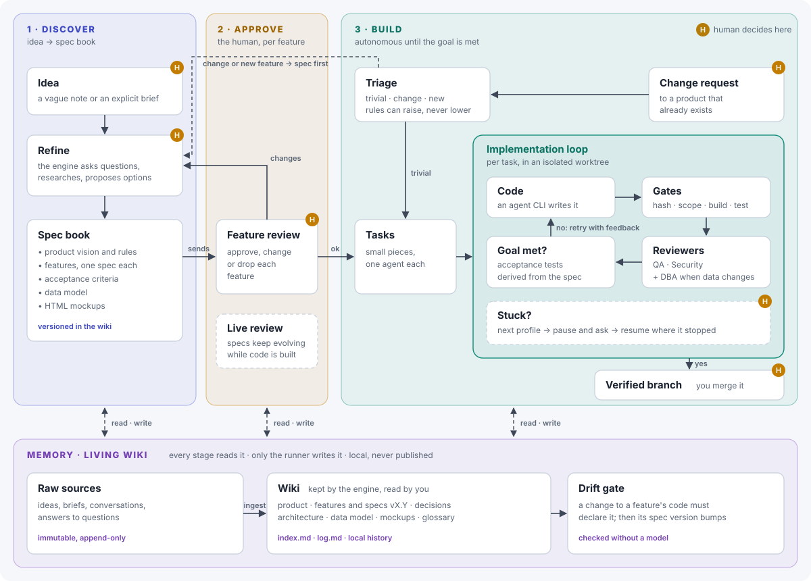
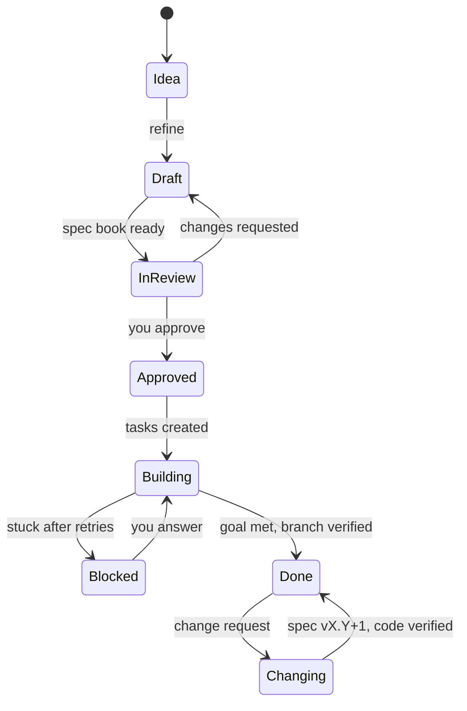
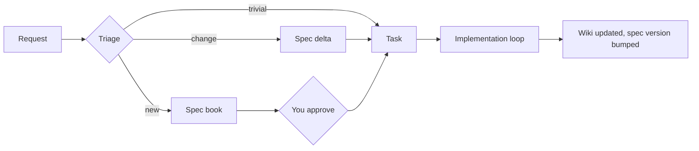

# AEH Vision

AEH takes a product from a first idea to verified, documented code, and remembers everything it learned along the way.

You start with a vague idea or an explicit brief. AEH refines it with you into a **spec book**: the product's vision, one spec per feature, acceptance criteria, the data model and HTML mockups that show how it all fits. Once you approve a feature, AEH builds it on its own: it splits the work into tasks and runs each task through a loop of coding, deterministic gates and specialist review (QA, Security, and a DBA when data changes) until the goal in the spec is met. Every stage reads a **living wiki** that the engine keeps up to date, so the project never loses its context. The wiki is local and private.



## Principles

- **Models propose, the runner decides.** Agents write specs, code and reviews. Acceptance comes from checks that do not depend on trusting a model.
- **Effort proportional to the change.** Changing a label does not need a spec cycle. A new feature with a database does.
- **Memory is part of the product, and it is private.** A change is not finished until the documentation that describes it is updated and versioned. The memory is stored locally and is not published by default.
- **The human decides at fixed points:** the idea, answers to questions, feature approval, pauses when the engine is stuck, and the merge.
- **Evidence over claims.** "Done" means the acceptance tests and the reviewers passed, with a report that shows it.

## Vocabulary

| Level | What it is | Who approves it |
| --- | --- | --- |
| **Product** | Vision, principles and limits. Changes rarely. | You |
| **Feature** | A complete capability a user can use. The unit of approval. | You |
| **Spec** | The versioned document that describes one feature: behavior, acceptance criteria, mockup, data, risks. | Approved with its feature |
| **Task** | A piece of a feature that one agent can finish in one loop. | Nobody: the engine generates it |
| **Attempt** | One agent run on one task. | Nobody: the gates judge it |

A feature has one spec. A spec produces several tasks. The acceptance criteria in the spec become executable acceptance tests that the engine writes and locks after you approve the feature.

## Feature lifecycle



## Triage: simple stays simple

Every request is classified before any work starts.

| Route | Example | What happens |
| --- | --- | --- |
| **Trivial** | A label, a color, a config value | Straight to a task, then build and test, then a patch note in the spec |
| **Change** | Adjust how an existing feature behaves | Spec delta. You are asked only if the acceptance criteria change |
| **New** | A new feature, a schema change, auth or payments | Full cycle: spec, mockup, approval, QA + Security, plus a DBA when data changes |

A model proposes the route. Deterministic rules can raise it but never lower it: touching migrations requires the DBA reviewer, touching auth requires the Security reviewer.



## The implementation loop

Each task runs in its own isolated worktree:

1. **Code.** An agent CLI (Codex, Claude Code or a local model) writes the change.
2. **Gates.** Locked tests unchanged, change within scope, build passes, tests pass. No gate calls a model.
3. **Reviewers.** QA and Security always; a DBA when the data model changes. Each reviewer is a different agent from the one that wrote the code.
4. **Goal met?** The acceptance tests derived from the spec pass. If not, the agent retries with the failure as feedback, then a stronger profile takes over, then the engine pauses with one question and resumes after your answer.

The result is a verified branch. AEH never merges; you do.

## Memory: the living wiki

The memory follows the [LLM Wiki](https://gist.github.com/karpathy/442a6bf555914893e9891c11519de94f) pattern, with one addition: a gate keeps it in sync with the code.

```
.aeh/memory/        local only: git-ignored, never pushed
  .git/             its own local repository, no remote
  raw/              ideas, briefs, conversations, answers. Append-only.
  wiki/
    index.md        catalog: every feature with its status and version
    log.md          what happened, when, at which code commit
    product.md      vision, principles, limits
    features/
      checkout/
        spec.md       versioned spec with a changelog
        mockup.html   how it looks
    decisions/      why things are the way they are
    data-model.md
    glossary.md
  schema.md         conventions the engine follows when it writes the wiki
```

The memory is private. It lives in `.aeh/memory/` in the project's main checkout, which `aeh init` adds to `.gitignore` and the scope gate will protect, so the memory directory never enters a commit. It is its own local Git repository: every spec version is a commit there. A version that was implemented records the verified code commit; drafts and approved specs that are not built yet have none. Branches and worktrees are cleaned up after a merge; the memory is never touched by cleanup. Agents propose updates; only the runner writes the memory. Discovery and approval record drafts and approved specs before any code exists; an implementation is recorded after its gates and reviews pass. That does not stop private text from being copied into tracked files. Agents receive only the spec of the feature they work on, inside their prompt, and that text goes to the configured agent provider. Until the process sandbox exists, agents run with the user's permissions and could copy memory content into an allowed file, so review covers that risk. Backing it up to a private remote is the owner's choice, not a default.

- **Ingest:** new input in `raw/` updates the pages it touches.
- **Read:** every stage starts by reading `index.md` and the relevant pages, so agents work with the real context.
- **Drift gate:** When a task changes code that belongs to a feature (by the paths its spec declares), the task must declare that feature. The check is deterministic and runs with the other gates; once the change is accepted, the runner bumps that feature's spec version and adds a changelog line. It checks ownership by paths, not whether the spec text matches the behavior.
- **Lint:** a periodic pass looks for contradictions, stale pages and orphans.

Example: changing the "Pay" button to "Confirm payment" moves `checkout` from v1.3 to v1.3.1, with one changelog line and one log entry. No spec cycle, no approval.

## What exists today

| Part | Status |
| --- | --- |
| Implementation loop: worktrees, gates, retry ladder, pause and resume, evidence report | Built and hardened (MVP-1) |
| Cross review by a different agent | Built, one generic reviewer |
| Specialist reviewers (QA, Security, DBA) | Planned |
| Living wiki and drift gate | Planned |
| Triage | Planned |
| Spec to tasks and acceptance tests | Planned |
| Discovery: idea to spec book with mockups | Planned |
| Live spec review while building | Planned |
| Process sandbox (container, no network) | Planned |

## Roadmap

Each slice is usable on its own.

1. **Memory.** The wiki layout, versioned specs, `index.md` and `log.md`, and the drift gate on top of the current loop.
2. **Triage and reviewers.** The three routes, the escalation rules, and QA, Security and DBA reviewers chosen by route.
3. **Specs to code.** An approved feature produces its tasks and its acceptance tests. You approve the feature, not the tests.
4. **Discovery.** From a vague idea to a spec book with HTML mockups, through questions and options.
5. **Live review.** Specs keep evolving with you while approved features are being built.
6. **Sandbox.** Agents run in a container with no network by default and only the worktree mounted.

Each slice is measured against using an agent CLI directly: human interventions, defects that escape, out-of-scope changes and time.
